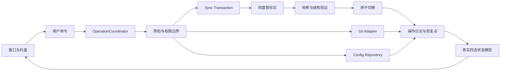

# Puppet Workspace EXE 审计与后续优化基线

> 文档用途：供后续 AI、开发者和审查者继续优化 `PuppetWorkspace.exe` 时作为统一问题基线。  
> 审计日期：2026-09-08  
> 审计方式：源码、配置、文档、日志、构建脚本及 EXE 元数据静态审查。  
> 证据边界：本轮未启动 EXE、未执行测试、未模拟磁盘满/断电/双实例等故障；动态行为需按本文测试清单继续验证。

## 1. 总体结论

当前工具已经具备仓库管理、技能同步、备份恢复、托盘、自启和 Git 操作等基本能力，但整体仍接近“Python 脚本集合加桌面 UI”，尚未形成可靠的桌面工具操作模型。

主要风险不在视觉层，而在以下四点：

1. 危险操作缺少事务边界，失败时可能留下半完成状态。
2. UI 文案、配置状态和实际执行行为不完全一致，可能误导用户。
3. 缺少单实例、互斥、取消和退出等待，并发操作存在竞态。
4. 构建、测试、版本和可观测性不足，出现问题后难以定位和追溯。

当前未确认必然导致永久数据丢失的 P0 问题，但存在多项应在继续扩展功能前优先处理的 P1 问题。

## 2. 后续 AI 执行约束

后续 AI 处理本文问题时必须遵守以下约束：

- 先修复 P1，再增加 Codex、Claude、Gemini 等新同步目标。
- 不得继续在现有流程上堆叠临时状态位和零散判断；并发、同步、恢复应先确定统一核心模型。
- 不得把“检查”和“执行修改”合并为同一交互语义。
- 所有涉及删除、覆盖、同步、恢复和 Git 写操作的流程，都必须具备明确的预检、执行、验证和失败恢复阶段。
- 每项修复必须补充失败路径测试，不得只验证成功路径。
- 修改现有行为前必须确认是否影响当前个人工作流、CLI 兼容入口和已有备份格式。

## 3. P1 问题：优先整改

### P1-01 同步过程不是原子操作

- 位置：`tools/puppet_workspace_core.py:553-565`、`517-526`
- 现状：同步和恢复会先删除旧目标，再逐个复制新目标。
- 触发条件：复制异常、磁盘空间不足、文件被占用、源文件变化、进程退出或哈希失败。
- 影响：ccSwitch 技能目录可能停留在只复制了一部分的新状态；原备份虽然存在，但系统不会自动回滚。
- 优化方向：先复制到同盘暂存目录，完成全量哈希和结构校验后再原子切换；失败时保留旧目标并清理暂存区。

### P1-02 目标所有权判断过于宽泛

- 位置：`tools/puppet_workspace_core.py:417-445`、`553-564`
- 现状：只要目标目录名以 `puppet-` 开头，就被认定为可由本工具删除和替换。
- 触发条件：用户或其他工具在 ccSwitch 中安装了同前缀技能；启用仓库为空时执行同步。
- 影响：不归 Puppet Workspace 管理的技能也会被替换；零来源同步可能清空全部 `puppet-*` 目标。
- 优化方向：引入受管目标清单，记录来源仓库、技能名、版本/哈希和最近同步批次；只删除清单明确拥有的目标。零来源同步必须单独确认。

### P1-03 缺少统一操作协调器

- 位置：`tools/puppet_workspace_actions.py:193-202`
- 现状：每次点击直接创建新线程，没有全局忙碌状态、资源互斥、任务队列或取消协议。
- 触发条件：连续点击按钮、托盘与窗口同时触发、后台刷新与手工操作重叠、启动多个 EXE 实例。
- 影响：配置写入、同步、恢复和 Git 操作可能交叉执行，结果不可预测。
- 优化方向：建立单实例锁和 `OperationCoordinator`；按资源定义互斥域，例如配置、目标目录、单个 Git 仓库，并明确可并行与不可并行操作。

### P1-04 退出会中断后台写操作

- 位置：`tools/puppet_workspace_actions.py:193-202`、`245-248`
- 现状：工作线程为 daemon；退出时直接停止托盘并销毁窗口，没有等待或取消后台任务。
- 触发条件：同步、clone、配置写入、提交或推送过程中退出程序或关闭系统。
- 影响：可能产生半复制目录、不完整配置、残留 Git 锁或用户无法理解的中间态。
- 优化方向：退出前检查活动任务；安全任务支持取消，写操作必须等待安全点完成；强制退出时记录恢复信息。

### P1-05 工作线程异常回调可能丢失原始异常

- 位置：`tools/puppet_workspace_actions.py:197-202`
- 现状：`except` 中的 `exc` 被延迟 lambda 捕获，回调执行时该异常变量可能已被 Python 清理。
- 触发条件：任意后台任务抛出异常。
- 影响：错误弹窗回调再次异常，真正故障原因无法展示，用户只看到操作没有完成。
- 优化方向：在创建回调时通过默认参数或结果对象冻结异常信息，并在工作线程内生成完整结构化错误记录。

### P1-06 “检查更新”实际执行 `git pull`

- 位置：`tools/puppet_workspace_pages.py:126`、`tools/puppet_workspace_core.py:616-619`
- 现状：界面使用“检查更新”文案，底层执行会修改工作区的 `git pull --ff-only`。
- 触发条件：用户只想查看远程是否有变化而点击该按钮。
- 影响：检查动作越权为写操作，可能改变工作树或因本地改动产生冲突。
- 优化方向：拆成“获取远程状态”和“拉取更新”两个动作；前者只执行 fetch/比较，后者显示分支、远程和预计影响后再确认。

### P1-07 Git 状态失败时可能显示假正常

- 位置：`tools/puppet_workspace_core.py:303-320`、`330-341`，`tools/puppet_workspace_view.py:45-56`
- 现状：`git_value` 丢弃错误；ahead/behind 查询失败时返回 `(0, 0)`；最终状态对象不一定包含错误。
- 触发条件：没有 upstream、Git 命令失败、权限异常、仓库损坏或输出格式异常。
- 影响：未知状态被降级成干净、无落后、无超前，并在 UI 中显示“一切正常”。
- 优化方向：状态必须使用“正常/警告/错误/未知”四态模型；任何关键命令失败都不得显示绿色。

### P1-08 “远程有更新”不是实时远程状态

- 位置：`tools/puppet_workspace_core.py:313-320`、`330-341`
- 现状：刷新只比较本地 upstream 引用，没有访问远程执行 fetch。
- 触发条件：远程在最近一次 fetch 后新增提交。
- 影响：后台所谓“检查状态”无法发现真实远程更新，提醒可能长期滞后。
- 优化方向：区分“本地缓存状态”和“联网刷新状态”；联网检查设置超时、取消和离线降级，并展示数据时间戳。

### P1-09 配置 remote/branch 与真实仓库脱节

- 位置：`tools/puppet_workspace_actions.py:117-141`、`tools/puppet_workspace_core.py:612-634`
- 现状：编辑 remote 只修改 YAML，不更新 Git origin；编辑 branch 不切换或校验当前分支。提交作用于当前分支，pull/push 使用配置分支。
- 触发条件：用户修改已存在仓库的 remote 或 branch，或当前 checkout 与配置分支不同。
- 影响：界面配置看似生效，实际 Git 仓库没有同步改变；可能提交一个分支却拉取/推送另一个分支。
- 优化方向：配置保存时验证实际 remote、当前分支和目标分支；禁止静默错位，并为“仅修改工具配置”和“修改 Git 仓库”提供不同流程。

### P1-10 “保存我的改动”会暂存全部文件

- 位置：`tools/puppet_workspace_core.py:629-634`
- 现状：提交前执行 `git add -A`，包含修改、删除和未跟踪文件；`git add` 返回码未检查。
- 触发条件：仓库内存在生成物、临时文件、意外删除或敏感文件。
- 影响：用户可能在“保存”这一弱语义下提交所有内容；暂存失败后仍继续尝试 commit。
- 优化方向：文案改为明确的 Git 术语；提交前展示分组 diff/文件清单，支持选择范围和敏感文件拦截；每一步检查返回码。

### P1-11 AI 技能导入缺少信任边界

- 位置：`tools/puppet_workspace_core.py:380-404`、`578-588`
- 现状：只检查 `puppet-` 前缀和 `SKILL.md`，随后复制整个技能目录。
- 触发条件：仓库包含未审查的提示词、Hooks、脚本、二进制文件、密钥或超大文件。
- 影响：未经确认的内容直接进入 AI 可调用位置，可能改变 AI 行为、暴露敏感文件或执行高风险脚本。
- 优化方向：同步前提供来源、diff、文件数量和风险摘要；增加敏感文件、可执行脚本、链接和体积检查；支持固定到已提交版本。

## 4. P2 问题：本迭代处理

### P2-01 配置格式名为 YAML，实为自制解析器

- 位置：`tools/puppet_workspace_core.py:118-189`、`229-243`
- 问题：不完整支持 YAML 的引号、转义、多行值、类型、注释和结构；保存时直接拼接文本。
- 影响：特殊输入可能破坏配置，保存会丢失注释；中途退出可能留下截断文件。
- 优化方向：使用正式 YAML 库并做 schema 校验；通过临时文件、flush/fsync 和原子替换保存。

### P2-02 配置恢复前没有内容验证

- 位置：`tools/puppet_workspace_core.py:538-550`
- 问题：只确认备份中存在 `repos.yaml`，随后直接覆盖当前配置。
- 影响：损坏、旧版本或不兼容备份会先成为正式配置，下一次刷新才失败。
- 优化方向：先解析、校验版本和所有仓库字段，再进入原子替换。

### P2-03 Windows 大小写冲突未识别

- 位置：`tools/puppet_workspace_core.py:391-404`、`578-588`
- 问题：技能名使用区分大小写的字典判重，但 Windows 文件系统通常不区分大小写。
- 影响：`puppet-Foo` 与 `puppet-foo` 可能在删除旧目录后才复制失败。
- 优化方向：按目标文件系统规则规范化名称，并在任何删除发生前完成碰撞检测。

### P2-04 AI 同步状态卡片不表示实际同步状态

- 位置：`tools/puppet_workspace_core.py:650-663`、`tools/puppet_workspace_view.py:59-69`
- 问题：虽然存在 `state/sync_state.json`，状态页没有读取或比对源、目标哈希；卡片只判断是否有同名冲突。
- 影响：源已变化或目标被手工修改时，界面仍显示“可以同步”，用户无法判断是否已同步。
- 优化方向：提供“已同步/待同步/目标被修改/状态未知”，并显示最近成功时间和批次。

### P2-05 UI 主线程执行多次 Git 查询

- 位置：`tools/puppet_workspace_app.py:103-111`、`tools/puppet_workspace_actions.py:45-60`
- 问题：刷新和选择仓库后的摘要查询在 Tk 主线程同步执行；每个仓库会启动多次 Git 子进程。
- 影响：仓库数量增加、磁盘慢或 Git 异常时窗口无响应。
- 优化方向：状态采集进入受控后台任务；设置每条命令超时，并在 UI 中显示进行中、过期和取消状态。

### P2-06 禁用仓库仍可能触发托盘告警

- 位置：`tools/puppet_workspace_core.py:698-716`
- 问题：告警键生成没有检查仓库是否启用。
- 影响：UI 显示“未启用”，托盘仍提醒 dirty/ahead，状态口径冲突。
- 优化方向：明确禁用含义，默认停止同步和告警；如需继续监控，做成独立设置。

### P2-07 备份与日志没有生命周期策略

- 位置：`tools/puppet_workspace_core.py:479-493`、`tools/puppet_workspace_actions.py:263-268`
- 问题：配置备份、完整技能备份、磁盘 JSONL 和内存日志均没有容量或数量上限。
- 影响：长期运行会持续占用磁盘和内存，完整技能副本可能大量重复。
- 优化方向：配置保留数量、总空间和最长天数；清理前展示范围；日志轮转并保留错误索引。

### P2-08 `start_minimized_to_tray` 是假设置

- 位置：`tools/puppet_workspace_support.py:17-30`、`83-90`，`tools/puppet_workspace_actions.py:176-179`
- 问题：配置项被读写，但程序是否隐藏只由启动参数决定；UI 保存时还会固定写为 `True`。
- 影响：配置表达与行为不一致，后续维护者会误以为功能已经接通。
- 优化方向：真正接入启动逻辑，或删除该设置并明确仅由 `--tray` 控制。

### P2-09 Git 仓库识别不支持 worktree

- 位置：`tools/puppet_workspace_core.py:222-226`、`330-341`
- 问题：仅接受 `.git` 为目录；正规 Git worktree 的 `.git` 通常是文件。
- 影响：合法仓库被拒绝，伪造空 `.git` 目录却可能通过初步检查。
- 优化方向：使用 `git rev-parse --is-inside-work-tree` 和 `--show-toplevel` 做物理验证。

### P2-10 状态展示会隐藏复合问题

- 位置：`tools/puppet_workspace_view.py:45-56`
- 问题：behind、ahead、dirty 采用优先级单选，只展示第一个命中的状态。
- 影响：例如仓库既落后又有未提交修改时，只显示“远程有更新”，用户可能直接触发拉取。
- 优化方向：状态模型保留所有事实，摘要可给主状态，但必须同时展示次级风险和推荐动作。

### P2-11 设置输入缺少 UI 层校验

- 位置：`tools/puppet_workspace_pages.py:86-96`、`tools/puppet_workspace_actions.py:176-179`
- 问题：刷新频率组合框可输入任意文本，保存时直接 `int()`，且没有统一异常处理。
- 影响：非法输入可能直接触发 Tk 回调异常。
- 优化方向：设置只读选项或在保存前做字段级校验，并给出就地错误提示。

### P2-12 打开路径前缺少存在性与错误处理

- 位置：`tools/puppet_workspace_actions.py:155-158`、`250-255`
- 问题：直接调用 `os.startfile`，未确认路径仍存在，也没有统一捕获 Shell 打开失败。
- 影响：备份被外部删除、仓库迁移或权限变化后，UI 回调可能直接异常。
- 优化方向：调用前验证目标，错误进入统一操作结果和高级日志。

## 5. 工程与发布债务

### E-01 核心模块职责过多

- 文件：`tools/puppet_workspace_core.py`，当前约 774 行。
- 问题：同一模块混合配置解析、Git、技能发现、同步、删除、备份、恢复、日志、状态和 CLI 调度。
- 要求：不要机械按行数拆文件；应按领域拆成配置仓储、Git 适配器、同步事务、备份仓储、状态查询和应用服务。

### E-02 旧 UI 实现作为代码尸体保留

- 位置：`tools/puppet_workspace_ui.py:48-355`、`358-359`
- 问题：文件先定义约 300 行旧 `PuppetWorkspaceApp`，最后再用新实现覆盖同名符号。
- 影响：阅读、静态分析、测试覆盖和后续修改都容易落到错误实现上。
- 要求：确认兼容导入需求后，将兼容层缩减成纯 re-export，不保留失效实现正文。

### E-03 入口使用通配符导入

- 位置：`tools/puppet_workspace.py:12`
- 问题：入口依赖不可见，核心模块任意新增符号都可能泄漏到入口命名空间。
- 要求：改成显式导入，保持 CLI 依赖边界可审核。

### E-04 构建不可复现

- 位置：`tools/requirements.txt`、`tools/build_exe.cmd:9-23`
- 问题：依赖不锁版本，没有固定 Python 版本和构建环境，也没有生成依赖清单。
- 要求：锁定直接和传递依赖；记录 Python、PyInstaller 和操作系统版本；生成构建清单与 SHA-256。

### E-05 正式 EXE 缺少身份与签名

- 已确认：当前 `PuppetWorkspace.exe` 没有 FileVersion、ProductVersion、ProductName、CompanyName、Description，也没有 Authenticode 数字签名。
- 影响：无法从文件属性判断版本和来源，对外分发时更容易被 SmartScreen 或杀毒软件拦截。
- 要求：至少加入版本资源、产品信息和构建提交号；若对外或跨设备分发，增加代码签名和时间戳。

### E-06 构建流程没有质量闸门

- 位置：`tools/build_exe.cmd:9-23`
- 问题：直接打包并覆盖正式 EXE，没有先运行测试、执行静态检查、验证启动、校验资源和比较版本。
- 要求：只有测试、静态检查、打包烟测和元数据检查全部成功后，才能替换根目录正式产物。

### E-07 可观测性弱于文档承诺

- 位置：`tools/puppet_workspace_actions.py:257-268`、`docs/usage.md:18-23`
- 问题：文档称高级日志保留错误堆栈，实际 UI 只保存异常类型和一句消息；抛出型异常也不一定进入磁盘操作日志。
- 要求：记录操作 ID、开始/结束时间、阶段、资源、返回码、完整 traceback 和用户可读摘要；敏感参数需脱敏。

### E-08 测试覆盖不足

- 文件：`tools/tests/test_puppet_workspace.py`
- 现状：主要覆盖基础成功路径和少量配置逻辑。
- 缺失：同步故障注入、自动回滚、零来源同步、大小写冲突、源中途变化、双实例、连续点击、退出等待、配置并发写、错误回调、Git 分支/remote 错位、worktree、超时、离线、日志轮转、EXE 启动烟测。

## 6. 建议目标架构

后续优化应先建立以下核心模型，避免继续由 UI 直接拼接底层函数：

核心原则：

- UI 只发命令和展示状态，不直接组织文件删除、Git 或恢复流程。
- 每个命令都有唯一操作 ID、资源锁、阶段、进度、取消策略和终态。
- “未知”不得降级成“正常”。
- 检查操作只读；写操作必须明确展示影响并获得确认。
- 同步完成的定义不是“复制函数返回”，而是“目标全量验证通过且切换完成”。

## 7. 推荐优化顺序

### 阶段 A：先止血

1. 修复异常回调丢失。
2. 加单实例和操作互斥。
3. 退出时阻止或等待写操作。
4. 把“检查更新”与“拉取更新”拆开。
5. Git 状态引入“未知”状态，禁止错误变绿色。

### 阶段 B：重做同步与恢复边界

1. 建立受管技能清单。
2. 使用暂存目录、全量校验和原子切换。
3. 增加自动回滚和恢复日志。
4. 处理零来源、大小写冲突、符号链接、文件占用和磁盘满。

### 阶段 C：统一 Git 与配置模型

1. 用正式 YAML 解析和 schema 校验。
2. 配置原子写入，恢复前验证。
3. 对齐配置 remote/branch 与真实仓库状态。
4. 提交前展示范围并做敏感文件检查。

### 阶段 D：改善 UI 与可观测性

1. 状态查询异步化并支持超时。
2. 显示活动任务、进度、失败阶段和恢复入口。
3. 展示真实同步状态及最近成功时间。
4. 日志增加操作 ID、完整错误链和轮转策略。

### 阶段 E：建立发布工程

1. 清理旧 UI 代码和通配符导入。
2. 锁定依赖和构建环境。
3. 在构建前执行自动测试和烟测。
4. 加入 EXE 版本资源、构建提交号、哈希和数字签名。

## 8. 必补测试清单

- 同步复制第 1、任意中间项和最后一项失败，旧目标均保持可用。
- 哈希不一致时不会切换正式目录。
- 源仓库在同步过程中变化时，操作失败且可解释。
- 启用仓库为零时不会无提示清空目标。
- 非本工具管理的 `puppet-*` 目录不会被删除。
- `puppet-Foo` 与 `puppet-foo` 在 Windows 上预检即拦截。
- 两个 EXE 同时启动时只有一个拥有写权限。
- 连续点击同步、恢复和 Git 操作不会并发写同一资源。
- 写操作期间退出时能够等待、取消或恢复，不产生中间态。
- Git 无 upstream、Git 不存在、仓库损坏、权限失败时显示“未知/错误”，绝不显示正常。
- 配置分支与当前分支不一致时阻止提交、拉取或推送。
- remote 配置与实际 origin 不一致时明确提示。
- worktree 仓库能够被正确识别。
- 非法 YAML、旧版本配置和损坏备份在覆盖前被拒绝。
- UI 刷新期间保持响应，所有子进程均有超时。
- 后台线程异常能展示原始错误并写入完整日志。
- EXE 启动、托盘、退出、自启快捷方式均有烟测。

## 9. 发布与放量闸门

在以下条件满足前，不建议继续扩大同步目标或对外分发：

- 同步/恢复故障注入连续 100 次，正式目标零中间态、零不可恢复失败。
- 双实例和连续点击测试无法形成并发写。
- 所有 Git 写操作都明确展示仓库、当前分支、目标分支、远程和影响范围。
- 任意状态查询失败都显示“未知/错误”，错误状态不得进入绿色正常口径。
- UI 主线程单次阻塞不超过 200ms；长任务均有进度、超时和终态。
- 配置写入和恢复具备原子性，并通过中断测试。
- 构建由锁定依赖生成，自动测试和 EXE 烟测通过。
- 正式产物具有版本元数据、SHA-256；跨设备或对外分发时具有有效数字签名。

## 10. 待产品确认项

以下决策会直接影响后续设计，开始大改前需要由产品所有者确认：

1. 工具是否永远只供当前用户本机使用，还是需要跨设备或对外分发。
2. `puppet-*` 是否全部默认归本工具管理，还是只管理自己同步过的技能。
3. “同步”应该镜像工作区当前内容，还是只同步已提交、已审核的 Git 版本。
4. “保存我的改动”是否允许等价于 `git add -A && git commit`。
5. 后台检查是否允许联网 fetch，以及离线时应显示什么状态。
6. remote/branch 是工具展示信息，还是工具有权修改真实 Git 仓库配置。

## 11. 当前风险判定

- 出现概率：高。状态误判和交互语义误导由当前实现决定；并发和半同步问题在重复点击、双实例、进程退出、文件占用或磁盘异常时触发。
- 长期定义：连续使用 30 天，或累计执行 50 次同步、恢复及 Git 写操作。
- 不修复的短期影响：窗口卡顿、错误提示丢失、误拉取、错误分支操作和半同步。
- 不修复的长期影响：目标技能与来源漂移、备份和日志膨胀、误提交敏感文件、状态页失去可信度。
- 决策建议：暂停扩展新同步目标，优先完成阶段 A 和阶段 B；仅限熟悉内部机制的个人受控使用。

