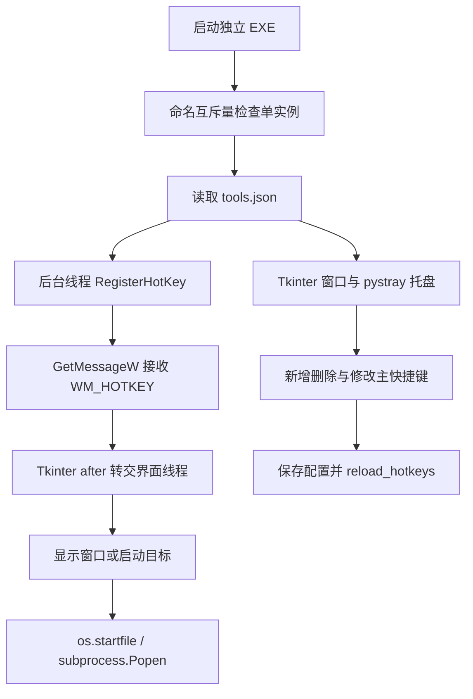

# 快捷键工具：原理、接入与优化方案

## 启动无响应与速度修复（2026-11-11）

用户反馈在 Puppet 内点击“启动快捷键工具”没有反应。实际进程显示仍在运行旧 dist/PuppetWorkspace.exe，并启动原 AutoHotKeyTool.exe；上一轮额外命名的更新版没有进入用户实际入口。旧工具已常驻时，再次启动不会显示窗口。

修复后的 Puppet 按钮会立即显示“正在启动”，等待时禁止连点；检测窗口出现、进程退出和 15 秒超时。已有新版窗口直接唤醒，不重复启动 EXE。两处原主程序入口均先备份，再更新。

快捷键新版默认目录式发布：`tools/快捷键工具/PuppetHotkeys/PuppetHotkeys.exe`，依赖库在其 `_internal` 目录；配置仍使用外层 tools.json。不能只复制该 EXE。外层原 PuppetHotkeys.exe 作为先前单文件构建保留。

正常用户环境、临时配置的一次测量：单文件版窗口出现 2.697 秒，目录式版 0.565 秒；直接唤醒约 0.0027 秒。该结果不是冷启动统计，耗时受缓存及安全软件影响。两版均通过隔离启动、唤醒和正常关闭验收；55 项回归测试通过。

还修复了退出后的 Tkinter 引用清理，避免循环引用在后台线程回收时触发 Variable.__del__／Tcl_AsyncDelete。原生回调保持只入队。构建脚本默认目录式，可用 `--layout onefile` 生成单文件版。以下保留上一轮交付记录，使用路径以本节为准。

## 2026-11-11：可维护新版

原工具没有源码，用户已授权按已分析功能重新实现。当前正式入口改为 `tools/快捷键工具/PuppetHotkeys.exe`；原 `AutoHotKeyTool.exe` 保留用于回退。下面原版分析继续保留作为历史依据，不代表新版仍使用原字节码。

新版使用现有 tools.json，交付过程不改写当前 7 项配置；只有用户在新版点击保存时才产生备份和原子替换。首次启动前从旧版托盘菜单退出旧程序，避免相同热键被占用。若旧版开机自动启动，还需在原工具或 Windows 启动项中关闭旧版自启。

已实现：工具新增／编辑／删除、主快捷键设置、按键录入、文件和目录拖放、程序／目录／网址启动、参数数组、托盘、重复启动唤醒、新版自启开关。自启仅在用户点击勾选框时修改当前用户的 PuppetHotkeys 项，不改旧版设置。

| 优化 | 新版行为 |
| --- | --- |
| 热键冲突 | 显示具体工具、Windows 原因；新增注册失败保留当前注册 |
| 动态生效 | 保存成功即应用，不重启；外部修改后点击“重新加载” |
| 保存保护 | 原文件备份到同目录 backups，临时文件写入并刷新后原子替换；检测外部修改 |
| 编辑保护 | 编辑期间暂停全局热键，避免录入组合时启动目标；关闭编辑窗口恢复 |
| 防连发 | RegisterHotKey 使用 MOD_NOREPEAT |
| 消息处理 | 原生回调只入队，界面轮询队列；不在 Win32 回调里重入 Tkinter |
| 启动响应 | 目标启动在工作线程执行，结果通过队列返回界面 |
| 排障 | 同目录 logs/hotkeys.log 轮转记录异常，crash.log 记录原生崩溃 |

配置错误时提示原因，不自动覆盖或重建默认配置。工具没有托盘支持时，关闭窗口会退出，避免窗口隐藏后无法找回。只要任一初始热键注册失败，本次整组注册取消，窗口保持显示；排除占用后点“重新加载”。

### 源码与构建

源码位于 tools/puppet_hotkey_*.py 与 tools/puppet_hotkeys.py，分为配置、热键事务、Windows 适配、启动目标和界面模块。每个模块均小于 500 行。

```text
python3 tools/puppet_hotkeys.py --help
python3 tools/puppet_hotkeys.py --check
python3 tools/puppet_hotkeys.py
python3 tools/build_hotkeys.py
python3 -m unittest discover -s tools/tests -v
```

新版构建排除 NumPy、psutil 等非必需依赖，构建脚本不覆盖原 EXE。配置中的 CMD/BAT 通过 Windows 文件关联启动，Args 按 Windows 参数规则传递；批处理自身仍须正确处理参数。网址目标自身不接收 Args；指定浏览器打开网址时，把浏览器设为 Path，把网址放进 Args。

### 验证与边界

当前 49 项测试全部通过，其中新版 19 项覆盖原配置键名、重复字段／热键、注释和未知字段保留、外部修改、原子替换失败与重试、EXE 参数、Windows 热键注册与消息、窗口唤醒、中文拖放消息、编辑保存和失败恢复、自启项隔离、重试期间外部修改及消息异常后的继续调度。测试使用临时配置及隔离组合键，未启动当前 7 项配置中的实际目标，也未真实修改自启注册表。

正式用户环境的 `python3 tools/tests/smoke_hotkey_exe.py` 已通过：打包 EXE 的配置校验、窗口启动、单实例唤醒、日志检查和正常关闭。受限沙箱中曾发生 Tcl 无法读取临时解包库的错误，同一产物在正常用户环境验收通过。新版 14,698,612 字节，比原版 32,218,839 字节减小约 54.4%。

当前 Puppet 主程序正在运行，无法覆盖原 dist/PuppetWorkspace.exe，更新版另存为 dist/PuppetWorkspace-updated.exe。请从托盘菜单退出正在运行的旧 Puppet 后打开更新版；也可直接运行 PuppetHotkeys.exe。根目录旧 EXE 与原快捷键 EXE 均保留。

测试中曾通过“隐藏测试窗口→注册隔离键→投递 WM_HOTKEY→Tkinter update”触发 PyEval_RestoreThread: NULL tstate。将原生回调中的 Tkinter after 改成纯队列入站后，该复现及编辑／拖放消息用例均通过。新增运行、启动与原生崩溃日志便于后续收证。仍需实际键盘和资源管理器拖放体验验收，不能把合成消息测试等同于全部桌面场景通过。

## 使用方式

⚠️ 已修正：本节以下保留首次接入原 EXE 时的历史说明；当前入口与操作以本文顶部“可维护新版”为准。

在 Puppet 左侧选择“快捷工具”，点击“启动快捷键工具”。也可直接运行工作区下 `tools/快捷键工具/AutoHotKeyTool.exe`。

工具以独立进程运行，拥有自己的窗口、托盘和热键监听；退出 Puppet 不会结束它。“打开配置目录”可找到 `tools.json`，建议优先使用原工具界面增删工具和修改主快捷键。若工具已经在运行，通过它的托盘菜单显示窗口。

Puppet 启动时明确设置工具所在目录为工作目录，使用参数列表启动 EXE，不经 Shell 解析。启动前检查 EXE 和配置存在；缺失时显示精确路径，不自动寻找其他副本。Puppet 不修改工具配置，也不自动设置它的开机自启。

## 分析依据与结论边界

分析对象为用户指定的 `D:/apps/tools/快捷键工具/AutoHotKeyTool.exe`，大小 32,218,839 字节。工作区现有 EXE 与其 SHA256 相同：`8AC719B37FD31B387C1DE6B0EB57D54D2F3830EFF5F926125540462C89B57FCF`，因此直接复用现有程序。

通过 PyInstaller 归档目录与内嵌 `main` 字节码的符号、常量确认：这是 Python 3.14 + Tkinter 程序，包含 pystray、Pillow、tkinterdnd2；名称中的 AutoHotKey 不代表使用 AutoHotkey 脚本。入口字节码约 45 KB。未取得原始源码，未完整反编译，也未实际触发用户的快捷键目标；以下将已确认结构与待验证风险分开表述。

## 核心链路



| 方法或符号证据 | 对应职责 |
| --- | --- |
| `load_tools` / `load_main_hotkey` / `save_config` | 读取和保存工具列表、主热键；存在按行处理注释的代码 |
| `parse_hotkey` / `KEY_CODES` | 将 Ctrl、Alt、小键盘等名称映射为修饰键与 Windows 虚拟键 |
| `listen_hotkey` / `RegisterHotKey` / `GetMessageW` / `WM_HOTKEY` | Windows 全局热键注册与消息接收，无需持续轮询按键 |
| `after` / `launch` / `show` | 将消息交给 Tkinter 窗口处理，执行工具或显示窗口 |
| `reload_hotkeys` / `PostThreadMessageW` / `UnregisterHotKey` | 通知监听线程更新注册并释放旧热键 |
| `create_tray` / `hide` / `quit` | 托盘显示、隐藏窗口及退出 |
| `CreateMutexW` / `AutoHotKeyTool_SingleInstance` | 命名互斥量单实例；常量中还出现 Global 命名空间 |
| `configure_startup` / `winreg` / `SetValueEx` | 存在通过当前用户注册表设置自启的实现；调用时机待验证 |
| `capture_hotkey` / `fill_dropped_path` | 按键录入及拖入路径 |

配置以 `MainHotkey` 控制主窗口，以 `Tools` 数组维护 `Name`、`Path`、`Description`、`Hotkey` 和可选 `Args`。现有工作区配置包含 7 个工具，区别于原目录的 5 个；本次完整保留工作区版本。

配置文件带 `//` 整行注释，并非严格 JSON。程序中存在动态重载路径，因此注释里的“修改配置后需要重启 EXE”不能当作所有操作的实际行为；界面修改与外部编辑是否采用相同刷新机制仍需运行验证。

## 方案选择

| 方案 | 优点 | 代价 | 本次选择 |
| --- | --- | --- | --- |
| Puppet 提供入口，复用独立 EXE | 保留已有功能与配置，接入改动小，退出 Puppet 后仍可用 | 仍依赖无源码的二进制，运行两个托盘程序 | 已实现 |
| 获取源码后维护独立热键工具 | 可修复监听和配置问题，减小打包体积，长期可维护 | 需要原源码或重新实现并逐项验收 | 后续优化建议 |
| 热键监听并入 Puppet 主进程 | 减少一个进程和托盘 | 共享生命周期，增加主程序线程及退出管理复杂度 | 不作为当前实现 |

## 优化优先级

以下是后续开发方案，不表示已在原 EXE 中确认这些缺陷，也没有修改 EXE。

1. **优先取得源码并建立可重复构建。** 将配置解析、热键监听、目标启动、界面分开维护；保留全部键名、网址、参数、拖放、托盘能力后再替换原程序。当前只有二进制，无法可靠修补内部逻辑。
2. **把热键冲突变成可见状态。** 检查每次 `RegisterHotKey` 的返回值与错误码；显示被其他程序占用的组合，校验工具之间及主热键的重复。固定命名互斥量可能使原目录与 Puppet 目录的两个副本不能并行；需实际验证并给出已有实例入口。
3. **由监听线程串行处理重载和退出。** 若源码审查发现跨线程注册问题，让同一消息线程负责注册、注销、重载；窗口更新通过界面队列处理。重载失败时恢复旧注册，退出时注销热键并关闭句柄，长按可考虑 `MOD_NOREPEAT`。
4. **可靠保存配置。** 同目录临时文件加原子替换，保留一次备份；区分空配置与解析失败，避免错误时覆盖原文件。对外部修改提供显式“重新加载”，验证成功后才替换运行配置。
5. **保持启动参数的边界。** 应用参数保持字符串数组，目录和网址使用明确路由；可执行文件使用 `shell=False`，为 CMD/BAT 单独规定转义策略。需审查原 `launch` 的完整字节码或源码后才能断言是否存在注入问题。
6. **缩小打包体积并校正文档。** 归档含 NumPy、psutil、SSL 等依赖，是否必要需源码导入分析确认。用干净构建环境只收集所需模块，测量体积、首次启动耗时和驻留内存；补充自动化构建及配置版本说明。

## 验证范围

本次验证 Puppet 入口以工作区路径定位原工具、检查文件缺失、使用独立进程及固定工作目录，并验证页面接线与主程序打包。不会通过测试启动配置中的 SVN、目录、浏览器等真实目标。

2026-11-11 验证结果：新增入口的中文空格路径、EXE/配置缺失拦截、启动参数及工作目录、错误提示、Tkinter 页面构建和导航接线检查通过；`python3 -m unittest discover -s tools/tests -v` 的 30 项现有回归测试全部通过。PyInstaller 构建成功，新版位于 `dist/PuppetWorkspace.exe`，已确认构建收集了新增入口模块。根目录旧 EXE 未覆盖，使用新版时请运行 dist 中的文件。

热键冲突提示、按键捕获、小键盘在 NumLock 不同状态下的行为、外部改配置后的刷新、自启和退出清理，需要在用户桌面运行验证；本次不将其标为通过。
